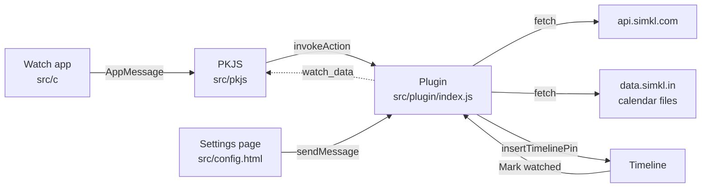

# Design

## Why it is built this way

The Pebble app no longer syncs timeline pins from a server: the timeline web API is gone, and an app can only add pins from its own JavaScript on the phone while that JavaScript runs ([Local Pins](https://developer.repebble.com/guides/pebble-timeline/timeline-local-pins/)). Something therefore has to start the app's phone code regularly. Simkl Timeline uses Pebble's Wakeup API for that, as Core Devices' own Sports app does.

The Simkl work lives in a plugin, in the same pbw as the watch app:

- the plugin keeps all its data, the Simkl sign-in included, in `Pebble.secureStorage`, which only the plugin can read;
- a pin's **Mark watched** button is a `pluginAction`, so it runs on the phone without opening the watch app;
- the settings page talks to the plugin while it is open, which the sign-in needs.

This needs the Pebble app 1.18 or later with plugins turned on.

## Parts

| Part | Job |
| --- | --- |
| Watch app (`src/c`) | The upcoming list, item details with Mark watched, the sign-in screen (code and QR code), the daily Wakeup sync and the app glance. It keeps the last list in persistent storage, so it opens instantly and works offline. |
| PKJS (`src/pkjs`) | The bridge. It runs the plugin's `sync` action, asks its `watch_data` action for what the watch shows, sends the list to the watch one message at a time, and draws the sign-in QR code. |
| Plugin (`src/plugin/index.js`) | The engine: Simkl sign-in, list sync, schedules, movie release dates, the timeline pins and Mark watched. |
| Settings page (`src/config.html`) | Sign in and out, every setting, sync status and Sync now. |

## When it syncs

| Trigger | Reason | Simkl lists checked? |
| --- | --- | --- |
| Daily Wakeup (06:00 by default, up to two times a day) | `scheduled` | No |
| Opening the watch app | `open` | If the last check is older than 15 minutes |
| Sync now (watch or settings page), finishing sign-in | `manual` | If the last check is older than 1 minute |
| Saving settings | `settings` | If the last check is older than 1 minute |

Simkl's API rules forbid background polling of the watchlist endpoints without user interaction. The daily Wakeup sync therefore only refreshes the airing schedules from Simkl's calendar files, which are public CDN files that don't count against the app's quota, and recomputes the pins from the lists cached at the last check. A show added on simkl.com appears on the timeline the next time you open the app or the settings page.

### List check

The plugin follows Simkl's two-phase sync. It reads `/sync/activities` first and keeps that answer as a snapshot. On the first sign-in it pulls each wanted list (`/sync/all-items/{type}/{status}`), one request at a time. Later checks stop when nothing moved, fetch `/sync/all-items?date_from=…` when a list moved, and diff `?extended=simkl_ids_only` against the cache when `removed_from_list` moved. The snapshot is saved only after every pull succeeded, so a failed pull is retried rather than skipped.

### Schedules

- TV and anime: the rolling calendar files `data.simkl.in/calendar/v2/{tv,anime}.json` (yesterday plus the next 33 days). The plugin sends `If-Modified-Since`, keeps only the entries for titles on your lists, and skips the download when its copy is less than 3 hours old.
- Movies: `/movies/{id}` for each Plan to Watch movie from last year or later, or with no year. Its `release_dates` list has dates per country and type: types 2 and 3 are cinema releases (wide preferred), type 4 is digital. When your country has no date of the chosen type, the US date is used and the pin says so. Lookups are cached for a day when a release is still ahead, and for a week otherwise. Up to 3 run at once, which Simkl allows for this cached endpoint.
- Anime films: the anime calendar gives a day in Japan, which is used as the release day.

### Time limits and waiting

The Pebble app gives a plugin action 20 seconds. `sync` therefore saves its progress after each step, stops starting new steps after about 12 seconds and answers `more`; PKJS calls it again, up to 10 times. The settings page has 5 minutes per message and runs the whole sync in one go.

The plugin engine has no timers: on Android, `setTimeout` and the other browser globals throw "not available to plugins", and on iOS they don't exist. So the plugin never waits. When it has to (Simkl answers 429 or 5xx, or another run holds the sync lock or is renewing the sign-in), it saves its place and answers `wait:<ms>` to PKJS, or `retryAfterMs` to the settings page. The caller waits that long and asks again. Simkl's `Retry-After` is used when it sends one, else 1, 2 and 4 seconds; after that the error is reported. A run lock keeps two runs from interleaving.

## Pins

| Item | Pin id | Time | Subtitle |
| --- | --- | --- | --- |
| TV episode | `tv-<simkl id>-<season>-<episode>` | air time, with the runtime as duration | `S2 E5` |
| Anime episode | `an-<simkl id>-<episode>` (`an-<id>-0-<ep>` for specials) | air time | `E148`, `Special E6` |
| Anime film | `an-<simkl id>-film` | release day at the chosen time | `Anime film` |
| Movie | `mv-<simkl id>-cinema`, `mv-<simkl id>-digital` | release day at the chosen time | `In cinemas`, `Digital release` |

Finales add `· Season finale` (or mid-season, series) to the subtitle. The body holds the episode title, the network and runtime, and the item's Simkl page (`simkl.com/tv/<id>/<slug>`), which Simkl's attribution rule asks for.

Pins cover two days back to the chosen number of days ahead. A pin is rewritten only when its content changed. When a pin is no longer wanted it is deleted if it is still in the future, or if its title left your lists or its type was turned off; past pins are left to age out. The Pebble app ignores an insert under a deleted id, so a title that comes back gets `-2`, `-3` … appended. The record of pins is forgotten 4 days after each pin's time.

**Mark watched** posts to `/sync/history` (anime under `shows[]` with season 1, as Simkl's docs show), deletes the pin and remembers the item, because the calendar keeps listing an episode after you watched it.

## Storage

Everything the plugin keeps is in `Pebble.secureStorage`, private to the plugin. It doesn't use `localStorage`, although the Pebble app shares it with PKJS. On Android, PKJS works on a copy of `localStorage` taken when the watch app starts and writes the whole copy back when it stops. Opening the settings page starts the watch app, so a sign-in the plugin stored in `localStorage` was erased as soon as the watch app closed. PKJS also never saw the plugin's later writes.

| Where | Key | Holds |
| --- | --- | --- |
| `Pebble.secureStorage` (plugin) | `tokens`, `device_code` | The Simkl access and refresh tokens, and the device code while signing in |
| `Pebble.secureStorage` (plugin) | `settings`, `account`, `signin`, `sync_status`, `upcoming` | The settings, the Simkl username, the live sign-in code, the last sync's outcome (with the time of the last good one), and the next 16 airings for the watch |
| `Pebble.secureStorage` (plugin) | `pins`, `plugin.*` | Pin record, cached lists, activities snapshot, calendar subsets, movie lookups, watched items, sync progress, locks |
| `localStorage` (PKJS) | `pkjs.data`, `pkjs.sentHash` | The last `watch_data` answer, shown at once on the next launch, and what was last sent to the watch |

`signin` never holds the device code, which is a credential, and `watch_data` returns neither. Tokens follow Simkl's one-owner rule: the plugin refreshes only within a day of expiry or after a `401`, and after a `401` it first re-reads the stored token in case another run refreshed it.

## Messages

### Settings page and plugin

The page waits for the plugin to be ready (`ready` event with target `plugin`), then calls `Pebble.sendMessage('plugin', …)`.

| Request | Answer |
| --- | --- |
| `{type: 'state'}` | account, live sign-in code, settings, sync status, permission states, version |
| `{type: 'saveSettings', settings}` | validates, stores and syncs, then `{ok, status}`; bad values get `{ok: false, error}` |
| `{type: 'signinStart'}` | `{signin}` with the code |
| `{type: 'signinPoll'}` | `pending`, `approved` (after the first sync), `expired` or `error` |
| `{type: 'signout'}` | revokes the token, clears the cache and deletes every pin |
| `{type: 'syncNow'}` | a full sync, then `{ok, status}` |

The plugin spaces sign-in polls itself (Simkl's `interval`, plus 5 seconds after `slow_down`), so a page that polls too fast can't get the code locked out.

### Watch and PKJS

PKJS gets what the watch shows from the plugin's `watch_data` action: the account, a sign-in code in progress, the sync status, the daily sync times and the upcoming list, as JSON. It asks when the watch app starts, after each sync, after Mark watched and when the settings page asks for a refresh.

Every message carries `Cmd`.

| Cmd | Direction | Meaning |
| --- | --- | --- |
| 1 HELLO | watch → phone | The app started; `Reason` 0 opened, 1 Wakeup, 2 timeline action |
| 2 SYNC | watch → phone | Sync now |
| 3 SIGNIN_START, 4 SIGNIN_STOP | watch → phone | The sign-in screen opened or closed |
| 5 MARK_WATCHED | watch → phone | Mark the item in `ItemFlags`, `ItemSimkl`, `ItemSeason`, `ItemEpisode` watched |
| 10 STATUS | phone → watch | `State` (ready, syncing, signed out, check the Pebble app, permission, offline, error), `Text`, `LastSync` |
| 11 ITEMS_BEGIN, 12 ITEM, 13 ITEMS_END | phone → watch | The upcoming list, one item per message |
| 14 SIGNIN_CODE | phone → watch | The code, its expiry and the QR code as a bit matrix |
| 15 SIGNIN_RESULT | phone → watch | Approved, expired or error |
| 16 SCHEDULE | phone → watch | The daily sync times |
| 17 RESULT | phone → watch | The outcome of Mark watched |
| 18 READY | phone → watch | The JavaScript has loaded; the watch holds its messages until this arrives, or for 6 seconds |

PKJS sends one message at a time and retries a rejected one twice. It sends the list only when it differs from what the watch last received, except after a Wakeup launch.

The settings page can also reach PKJS (target `pkjs`) while the watch app is open. After signing in or out, saving or syncing, it sends `{type: 'refresh'}`, and PKJS sends the watch its schedule, status and list.

## Watch app

| Window | Shows |
| --- | --- |
| List | A status bar (Synced 08:30, Syncing…, or what is wrong), then the airings grouped by day. A problem or the sign-in prompt is the first row, and is selected when it appears. Select opens an item; Select on the message or Sync now row, or holding Select anywhere, syncs. |
| Detail | Title, episode, finale badge, date and time, episode title, network and runtime. Select opens an action menu with Mark watched. |
| Sign-in | The QR code for `simkl.com/pin?user_code=…`, the code in large type, `simkl.com/pin`, and the minutes left. It closes itself once the code is approved. |

- Storage: key 1 holds the status, last sync and sync times (108 bytes); keys 16 to 31 hold one item each (140 bytes). A list is written only when it changed, and only after the whole list arrived.
- Wakeup: every launch and every SCHEDULE message replaces the wakeups with the next one or two daily sync times. A Wakeup launch shows "Syncing Simkl…", sends HELLO and exits when the list arrives, on an error, after 60 seconds, or at once when the phone isn't connected.
- App glance (not aplite): on exit, one slice per upcoming item, each ending when its item starts, such as `In 5 days: Dexter: Resurrection, S2 E3`.
- Bluetooth: the faster sniff interval is on only while a reply is expected, with a 60 second limit.
- Platforms: round screens (chalk, gabbro) centre the focused row; black-and-white screens (aplite, diorite, flint) use black and white highlights; emery and gabbro use larger fonts. Aplite starts with about 7 KB of free heap, and a full list needs about 4.5 KB while it arrives; if that allocation fails, the app frees the shown list and reloads it from storage afterwards.

## Testing

- `npm test` runs the plugin tests (`node --test test/*.test.cjs`). They load `src/plugin/index.js` in a sandbox that, like the Pebble app's plugin engine, has no timers or browser globals, with a fake `Pebble`, `fetch` and secure storage. The sandbox's `localStorage` throws, because the plugin must not use it. The tests cover the calendar join, anime numbering, cinema and digital release dates with the country fallback, pin ids, updates and deletions, reminders, the two-phase list sync, token refresh, the sign-in polling, the resumable sync, waiting out a busy Simkl, the run lock and `watch_data`.
- The emulator's PKJS and plugin read and write one live `localStorage`, unlike Android's PKJS copy, so the emulator can't show a plugin's `localStorage` writes being lost.
- The emulator's plugin host is not locked down like the Pebble app: it has `setTimeout`, so a plugin that needs a timer works there and fails on a phone. The test sandbox is the check for that.
- `pebble build`, then `pebble install --emulator emery` (Pebble Time 2). The emulator (pebble-tool 5.1.2) runs the watch app, PKJS, the plugin and the settings page together. It doesn't give plugins `Pebble.insertTimelinePin` or run `pluginAction` buttons, so pins and their Mark watched button need the real Pebble app.
- Like the original Pebble app, the emulator only sends the watch pins from yesterday to 3 days ahead, and the watch's timeline only shows that range. Pins further ahead are kept on the phone and reach the watch as their day comes closer; the app's own list shows the whole window.
